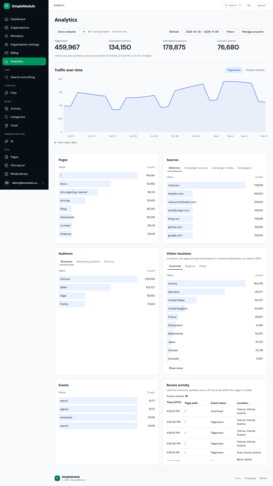
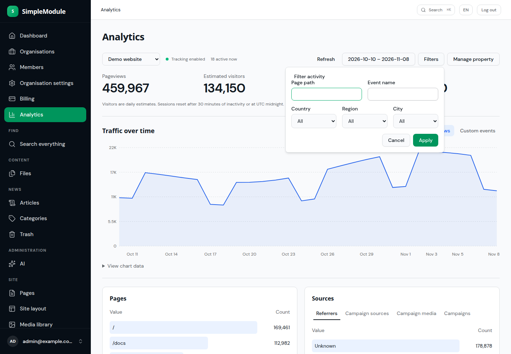
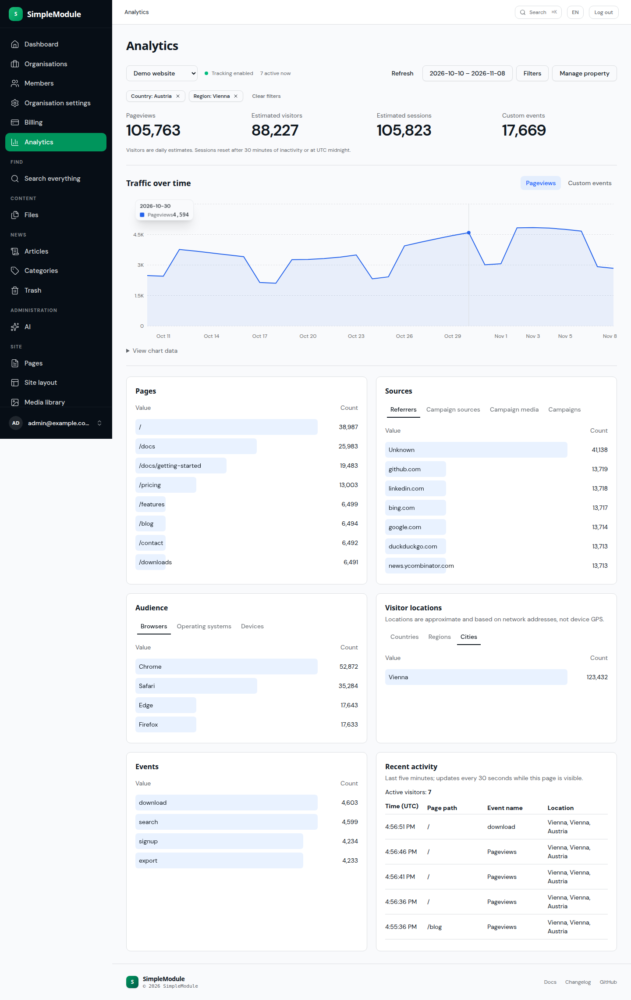
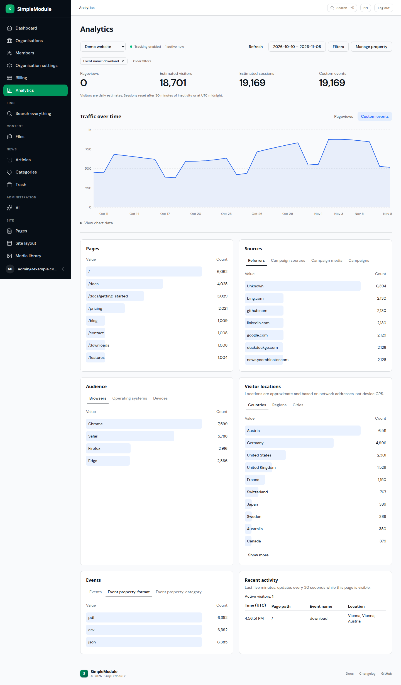
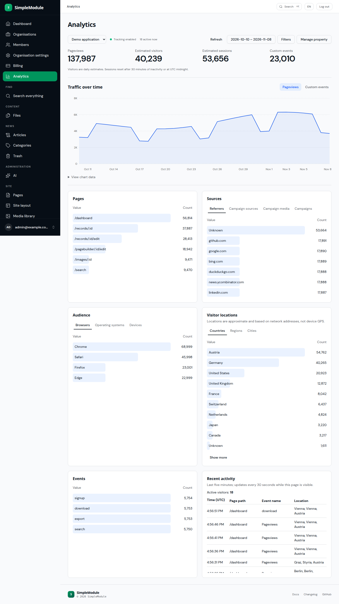
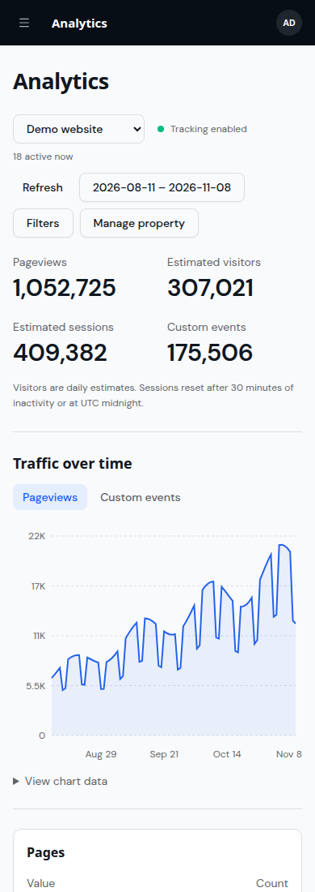
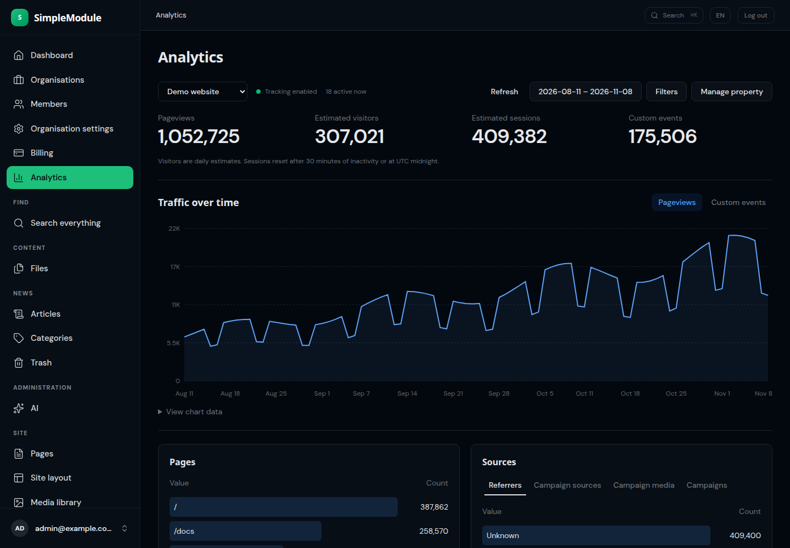

# Analytics UI snapshots for PR #323

These seven browser captures are review evidence for [PR #323](https://github.com/antosubash/smpy_modules/pull/323).

- Application source: `8fbbac30d3a3660de905904666ec039ac8fb5d2f` (`8fbbac30`).
- All traffic is synthetic: **1,596,703 activities** (1,228,231 public and 368,472 application).
- Captured from the real production bundle and API after performance testing.
- This temporary orphan branch contains only screenshots, this README and the capture manifest; it does not change the application branch.

## Desktop Overview

Demo website, 30 UTC days; 459,967 pageviews and 76,680 custom events. Synthetic traffic, real production bundle/API.

## Filters Open

Compact filter popover over the same real synthetic 30-day report; no applied filters.

## Geography Austria Vienna

Austria → Vienna region drilldown, Cities tab; 105,763 pageviews and 17,669 events over 30 days. Synthetic traffic.

## Events Format

Download events, Events chart and format property breakdown selected; 19,169 matching custom events across 30 days. Synthetic traffic.

## Application Normalized Paths

Demo application, 30 days; 137,987 pageviews and 23,010 events with normalized :id routes. Synthetic traffic.

## Mobile 390Px

390×1100 clean mobile viewport; Demo website, 90 dates, 1,052,725 pageviews and 175,506 events. Synthetic traffic.

## Dark Desktop

1440×1000 actual automatic system dark theme. Demo website, 90 days, real synthetic API data; 1,052,725 pageviews and 175,506 events; chart #60a5fa. No DOM class injection.

