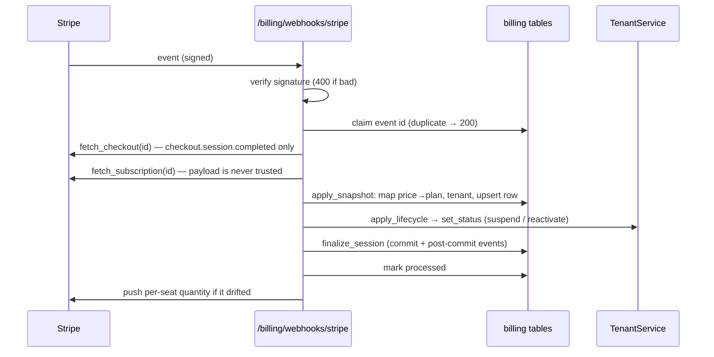

# Billing architecture

Design record: `docs/superpowers/specs/2026-10-01-billing-module-design.md`
(repo root). This page describes the code as it is.

## Boundaries

Billing sits on top of `simple_module_tenants` and uses only the seams that
module publishes; it adds nothing to `tenants_tenant` and nothing in `tenants`
imports billing.

| Seam (from `tenants`) | Billing uses it to |
|---|---|
| `app.state.tenants.entitlements` (`EntitlementProvider`) | answer `limit` / `has_feature` from the plan in force (`entitlements.PlanEntitlements`, installed in `startup.run`) |
| `TenantService.set_status` | suspend on `unpaid`, reactivate on recovery (`lifecycle.apply_lifecycle`) |
| `MembershipAdded` / `MembershipRemoved` | push the member count to Stripe for per-seat plans (`seats.subscribe`); skipped once the tenant is gone |
| `TenantDeleted` (0.0.38+) | cancel the tenant's subscriptions at Stripe immediately, then resync the local row (`teardown.subscribe`); reconcile sweeps deleted tenants whose teardown is unfinished (`sweep.sweep_deleted_tenants`: backoff, the tick's error budget, never on a single-tenant host) |
| `require_active_tenant`, `tenant:<role>` roles | scope every tenant route to the session's organisation |

Stripe is behind `contracts/provider.py` (`BillingProvider`), which speaks
plain dataclasses. No Stripe object crosses it.

## Data

| Table | Key | Holds |
|---|---|---|
| `billing_plan` | `id`, unique `key`, unique price IDs | price IDs, display amounts, `limits` (JSON `{key: int}`), `features` (JSON list), default/public/archived |
| `billing_customer` | `tenant_id` | Stripe customer id, the one open Checkout session id, `teardown_done_at` (deleted tenant fully canceled), `teardown_attempts` and `teardown_next_attempt_at` (its retry backoff) |
| `billing_subscription` | unique `tenant_id`, unique `provider_subscription_id` | the local mirror: plan, status, interval, quantity, trial end, period start and end, `cancel_at_period_end`, `suspended_by_billing`, `synced_at` |
| `billing_webhook_event` | provider event id | `processed_at`, `error` — idempotency and an audit trail |
| `billing_usage_event` | `id`, unique `(tenant_id, meter, idempotency_key)` | the append-only metering ledger: consume, record, refund and adjust rows, each with the `period_start` it counted against |
| `billing_usage_period` | `(tenant_id, meter, period_start)` | the per-period counter (`used`, `period_end`) the conditional upsert enforces on, and `provider_period` (the row counts a provider's period, not a calendar month) |
| `billing_usage_gauge` | `(tenant_id, meter)` | a gauge's current level (`in_use`), the sum of its live holds |
| `billing_usage_hold` | `id` (random 128-bit hex), unique `(tenant_id, meter, idempotency_key)` | one reservation against a gauge, or a key's terminal outcome: `quantity`, `status` (`held`, `committed`, `released`, `expired`; the outcomes `refused`, `expired_call`, `closed`), `expires_at`, `settled_at`, a `swap`'s `replaces_hold_id` and `not_after` |

One subscription row per organisation. `tenant_id` is a plain column, not a
foreign key: each module owns its own SQLAlchemy `MetaData`, so a cross-module
FK cannot resolve (`tenants` stores `user_id` the same way). None of the tables
use `MultiTenantMixin`: webhooks, reconcile and the admin list span
organisations by nature, so every query filters on `tenant_id` explicitly.

## Which plan is in force (`resolve.effective_plan`)

```
subscription.status in {trialing, active, past_due}  →  subscription's plan
anything else (no row, canceled, incomplete, unpaid) →  the default plan
```

Exactly one plan is the default, it is free, and it can be neither unset nor
archived (`plans.PlanService` enforces this), so resolution is total. Archived
plans still resolve for the organisations on them. There is no cache: a
per-process cache would be stale across workers, and the lookup is two indexed
reads.

## From Stripe to local state



Because every event re-fetches, whichever delivery lands last writes Stripe's
current view; out-of-order and duplicate deliveries are harmless. A failure
records `error`, leaves `processed_at` empty and returns 500, so Stripe's retry
reprocesses it. Two outcomes are acknowledged instead of retried forever —
`unknown_tenant` (a subscription that is not ours) and `nothing_to_apply` (a
lapse for a price we never knew, with no local row) — because a permanent 500
gets the endpoint disabled for every organisation.

`sync.apply_snapshot` is the only code that turns provider state into local
state; webhooks, reconcile, the admin **Resync** and plan changes all go
through it (`sync.resync` = fetch + apply). Its rules:

- the tenant comes from subscription metadata (`tenant_id`, set at Checkout),
  else from the Stripe customer id, else `unknown_tenant`. Only a completed
  Checkout may supply one more source, the `client_reference_id` of the session
  as re-fetched from Stripe (`fetch_checkout`); nothing is ever read from the
  payload, which is why `WebhookEvent` carries ids and no tenant. Anyone can
  open a Checkout naming any tenant (a Payment Link takes `client_reference_id`
  from its URL), so the reference counts only when the session and the
  subscription have the same customer, the tenant has no stored customer or
  that one, and the customer is not another tenant's. Otherwise the event is
  acknowledged as `ignored_customer_mismatch` and nothing is overwritten;
- a lapsing status with an unknown price still applies on the plan the
  organisation had, so an unmappable price never keeps paid access alive; an
  entitling status with an unknown price is an error, never the default plan;
- a canceled snapshot for an organisation's *previous* subscription is ignored
  when a different one is live.

## Lifecycle (`lifecycle.decide`)

A pure function of `(subscription status, suspended_by_billing, tenant status)`:

| Status | Tenant active | Tenant suspended by billing | Tenant suspended by an admin |
|---|---|---|---|
| `unpaid` | suspend, mark `suspended_by_billing` | no change | no change (never claimed) |
| any other | no change | reactivate, clear the mark | no change (never lifted) |

## Checkout and plan changes (`checkout.BillingService`)

Nothing here grants a plan. Checkout returns a Stripe URL; only the webhook
writes the subscription. Guards, in order: provider supports checkout; plan is
public and not archived; plan is paid and has a price for the interval; no live
subscription locally; seats fit; then, once the Stripe customer exists, no live
subscription **at Stripe** either (`live_subscription_ids`). The previous
open Checkout session is expired before a new one is created, so two tabs
cannot buy two subscriptions. The trial applies only if the organisation never
had a Stripe subscription. The Stripe customer is created with an idempotency
key derived from the tenant and its name/email, so a retry after a failed
Checkout reuses it.

## Restore mode (`context.billing_context`)

The tenants resolver never makes a suspended organisation the active tenant.
Billing's tenant routes resolve their own context: if the session's chosen
organisation is suspended **by billing** and the user is its **owner**, status
and the portal open for it (`restore=True`); checkout and plan changes stay
closed. An admin-suspended organisation is never restorable.

## Transactions — the rule that bites

Every session from `app.state.sm.db.session_factory()` is a `RequestSession`.
`TenantService.set_status` queues `TenantStatusChanged` and the membership-cache
invalidation with `db.on_commit`, and those callbacks run only through
`simple_module_db.finalize_session(session)`. **Code outside a request
(webhooks, reconcile, CLI, event handlers) must commit with
`finalize_session`, never a bare `commit()`**, or the suspension happens in the
database while every member's cached view still says active.

Plan writes flush inside a savepoint (`begin_nested`) so a concurrent create
that hits a unique constraint becomes `409 plan_key_taken` / `price_taken`
instead of a 500, and the request session stays usable.

## Usage metering (`metering/`)

`UsageService` (`app.state.billing_usage`, installed in `startup.run` once the
session factory exists) counts per tenant, meter and period, and holds gauge
capacity. Meters are registered on `app.state.billing_meters`
(`MeterRegistry`, created in `register_settings`, so it exists before any
module's `on_startup`); a call on an unregistered meter, or one of the other
kind, raises `UnknownMeterError`. Startup refuses any database but Postgres
and SQLite 3.35+ (`sql.ensure_supported`): the primitive needs `RETURNING`
and `ON CONFLICT … DO UPDATE … WHERE`.

### Periods (`metering/periods.py`)

The period is the subscription's provider period
(`current_period_start`/`_end`, written only by `sync.apply_snapshot`) when
the subscription is entitled and `now` is inside it, else the UTC calendar
month. A manual assignment (`admin.assign`) clears the provider's period
along with its subscription id, so the subscription row stays the one source
of truth: a tenant moved off Stripe mid-period resets on the 1st, not on the
old Stripe renewal. It keeps `trial_end`, the trial history checkout reads
(one trial per organisation); metering never reads it. Rollover needs no
job: a new period is a new `period_start`, so its first call inserts a fresh
counter row and the old rows stay as history. If the provider moves its
anchor (a new `period_start`), usage does not carry over. `record` counts
against the period current when it is recorded; its `occurred_at` is kept on
the ledger row for reference only.

### Transaction rules

- **Every write is its own short transaction**, opened from
  `app.state.sm.db.session_factory` and finished with `finalize_session`,
  never a bare `commit()` (`metering/tx.run_write`). The statements are Core
  DML, so the wrapper calls `mark_written` first or `finalize_session` would
  see nothing to commit. A replay or a refusal rolls the session back,
  ledger row included. The counter's row lock is held for the length of two
  statements.
- **`db=`** (`consume` and `record` only) runs the same statements inside
  `db.begin_nested()`, a savepoint of the caller's transaction, so a refusal
  or a replay rolls back only the metering and the usage commits with the
  caller's own write. The row lock is then held **until the caller commits**:
  on Postgres every other call for that tenant and meter waits behind the
  caller's remaining work. Pass `db=` only when that rest is short. In `db=`
  mode the limit and period are read through the caller's session, not a
  separate one.
- **Holds have no `db=` mode.** A hold must be visible to other requests
  before the caller's work finishes, and it outlives the request.
- **Read, then write, in separate sessions.** The plan's limit and the
  current period are read in a short session of their own
  (`core._resolve`, `effective_plan` plus the period rule), closed before the
  write session opens. The write session's first statement is a write (the
  ledger or hold `INSERT`).
- **Lock order: subscription, then rollup.** A counter upsert reads the
  tenant's subscription row `FOR SHARE` inside the same statement (see the
  moved period end below) before it writes the rollup. `sync.apply_snapshot`
  updates the subscription, flushes, and only then moves the rollups
  (`_follow_period_end`). Both take the locks in the same order, so a
  concurrent sync and consume wait on each other instead of deadlocking.

### The primitive (`metering/sql.py`, `hold_sql.py`)

Enforcement is one statement, so no check can be split from its write:

1. `INSERT … ON CONFLICT (tenant_id, meter, idempotency_key) DO NOTHING
   RETURNING id` claims the key; no row back is a replay, answered from the
   ledger, but only when the stored quantity, kind and source match the call
   (otherwise `IdempotencyConflict`, 409), and as `Refunded`, not admitted,
   once a `<key>:refund` row exists.
2. `INSERT … ON CONFLICT (tenant_id, meter, period_start) DO UPDATE SET used =
   used + qty WHERE used + qty <= limit RETURNING used`; no row back is a
   refusal, and the transaction (ledger row included) rolls back. The insert
   half has no `WHERE`, so a call with `qty > limit` instead runs `UPDATE …
   SET used = used + qty WHERE … AND used + qty <= limit`, which never
   inserts: refused when there is no row yet, admitted on a counter an admin
   credited below zero when it still fits. `check` and `consume` agree.

`record` and `adjust` run the same upsert with no limit. `refund` claims
`<key>:refund` and decrements the row of the `period_start` the original
counted against, not the current one. Refused attempts write nothing, so
there is no ledger of denials; they are logged at INFO with the tenant and
meter.

A gauge `reserve` has the same shape on `billing_usage_hold` and
`billing_usage_gauge` (`in_use = in_use + qty WHERE in_use + qty <= limit`).
Capacity comes back only through one guarded transition,
`UPDATE billing_usage_hold … WHERE id = :id AND status IN (…) [AND expires_at
<= now] RETURNING …`, followed by the gauge decrement in the same
transaction. Release, sweeper expiry and a late `commit`/`extend` that finds
the hold lapsed all go through it, and only the call whose `UPDATE` matched
lowers the gauge, so a hold is returned exactly once however many callers
race. `recount` (the admin repair) upserts the gauge row first to take its
lock, then sets `in_use` from the `SUM(quantity)` of the held and committed
holds.

### Why it is race-safe

- **Postgres (READ COMMITTED).** Two concurrent upserts on one row: the
  second waits on the row lock (or on the unique index for the very first
  insert). When the first commits, Postgres re-evaluates the `DO UPDATE …
  WHERE` against the committed row version (the documented `ON CONFLICT`
  guarantee). With a limit of 1 the second sees `1 + 1 > 1`, updates nothing
  and returns no row: exactly one is admitted. No advisory lock is needed,
  because nothing reads a sum and then inserts.
- **SQLite.** There is one writer. The trap is pysqlite's deferred `BEGIN` in
  WAL mode: a transaction that *read* before it writes holds an old snapshot,
  and its first write fails with `SQLITE_BUSY_SNAPSHOT`, which `busy_timeout`
  cannot wait out. Because the reads happen in a separate, closed session
  and the write session starts with the `INSERT`, the write lock is taken at
  once; a concurrent writer waits on `busy_timeout` and its statement then
  runs against the committed state, so the `WHERE` sees the first writer's
  increment. Any metering write that still cannot get the lock fails closed
  (`tx.run_write` maps SQLite's "database is locked" for every wrapped
  write): 503 `usage_busy`, nothing counted and nothing admitted. It is most
  likely with `consume(db=…)` or `record(db=…)`, whose caller read first, but
  an own-transaction write under heavy contention can also run out of
  `busy_timeout`.
- `tests/test_usage_concurrency.py` and `tests/test_usage_hold_races.py` race
  real connections on a file SQLite database and on Postgres; removing the
  upsert's `WHERE`, or the status guard from the settle transition, fails
  them.

### A period whose end the provider moves

Stripe can move a period's end while keeping its start (the rows are keyed
on the start, so writes keep landing in the same row). The stored
`period_end` must stay the period's real end, because the admin screen's
"previous period" is found by its exact boundaries. Two rules keep it so:

- **The sync moves the rows.** `sync.apply_snapshot` runs
  `sql.extend_rollups` after the subscription write: every counter row of the
  tenant starting at the subscription's `current_period_start` gets its
  `current_period_end` and `provider_period = true`. While the subscription
  is entitled that is every row at that start (a consume writes into it from
  now on, even a row written as a calendar month while it lapsed). While it
  is lapsed only rows already marked `provider_period` move; a calendar
  month written during a lapse keeps its own end even when its start
  coincides with the provider's.
- **A write stores the subscription's end, not its own.** The period is
  resolved in an earlier read, so a sync that moved its end in between
  (later *or* earlier) would otherwise have the write store a stale end: a
  new row the sync found nothing to move, or an existing row the sync
  already moved, moved back. Each counter write therefore reads, in the same
  statement and under `FOR SHARE`, the entitled subscription whose period
  starts at the resolved start (`_sub_end`). A write that resolved the
  subscription's own period takes its end even when a sync has since moved
  it to before the write's `now`. A write that fell back to the calendar
  month takes it only while that period is still running: after a missed
  webhook a period already over may share its start with the month, which
  keeps the month's end. The insert stores that
  subscription's end, else the resolved one, and marks the row
  `provider_period` when the subscription supplied it. On conflict (and in
  the `qty > limit` `UPDATE`) the row takes the subscription's end when
  there is one, earlier or later, and otherwise keeps its stored end
  (`_authoritative_end`): a write never stores an end the subscription does
  not currently have, so neither an extension nor a shortening (#240) can be
  undone by a racing write. `provider_period` is sticky (`OR`). The
  returned `Allowed.period_end` is the stored end. A sync whose subscription
  update is in flight is waited for; one that starts after the read waits
  for this write to commit and then moves the row. SQLite ignores the lock
  clause; its single writer already orders the two.

The usage screens read the period with the same rule enforcement uses
(`effective_plan` plus `current_period`), and the admin overview shows the
current row with the resolved end, so a stale stored end never shows as
current.

### Holds and the sweeper

`commit` clears `expires_at` (the hold stays counted until released);
`extend` pushes a held hold's expiry; `holding()` reserves on entry and
releases on exit, shielded from cancellation. A hold that is neither
committed nor extended lapses, and `metering/sweeper.UsageSweeper` (started in
`startup.run` next to the reconcile loop on every instance, stopped in
`on_shutdown`) expires up to 500 lapsed holds a tick through the guarded
transition. On several instances two sweepers may pick the same hold; the
guard moves it for one of them. There is no lease: the guard is the claim, as
in the reconcile scheduler. The same loop purges the ledger once a day per
process (`metering/retention.py`, see [operations](operations.md#usage-metering)).

### Changes from the design

The approved design is on issue #99. The code differs from it where review
changed it:

- A replayed `Idempotency-Key` on a `RequiresQuota` route never re-runs the
  handler (409 `idempotency_replay`), instead of "a retried request is free";
  a refunded key is spent (409 `idempotency_key_spent`).
- `RequiresQuota` is function-scoped (FastAPI 0.121+), so a client that
  disconnects after the handler returned refunds nothing.
- No `sm_lease` around the sweep (the guarded transition is the claim).
- `summary` is not on the `UsageMeter` protocol; the card is
  `metering/report.tenant_summary`.
- An adjustment is Core DML in the service's own transaction, so the ORM
  audit does not see it; its ledger row (kind `adjust`, `actor`, `reason`,
  `source = admin`) is the audit record.
- Pagination is billing's own (`report.page_numbers`), and the client uses
  billing's `api()` helper, to keep the `>=0.0.36` framework floor.
- The ledger purge goes by the charge's server-side `recorded_at`, never the
  caller-supplied `occurred_at`, and a refund goes with its charge.

## Settings and secrets

`BillingSettings` subclasses `DbBackedSettings` (no env sources) and is
registered with `register_module_settings`. `provider` and
`reconcile_interval_minutes` are first read in `on_startup`
(`providers.factory.install_provider`, `startup.start_reconcile`). A `stripe` choice with a
missing or undecryptable secret falls back to `ManualProvider` and records
`provider_error` for the admin screens — the app still boots. After that,
`live.py` subscribes to the framework's `SettingsReloaded`: a save that changes
`provider` or a Stripe secret rebuilds the provider with the same
`install_provider`, and one that changes those or the interval calls
`startup.sync_reconcile`, which starts, stops or re-times the loop (a loop
already at the wanted interval is kept). The swap is one attribute assignment
on the event loop, under a lock so two saves cannot both start a loop; every
caller reads `services.provider` per request or per tick. The framework's
reload is per process, so `live.ensure_current` covers the other workers: a
router dependency on every billing route, the seat-push handler and each
reconcile tenant re-read `provider`, the two secrets (as ciphertext) and the
interval from the settings table and rebuild the same way when they differ. A
loop that finds itself stale ends its tick; one told to stop mid-claim hands
the claim back (`scheduler._claim_safely`) before the cancel propagates. Secrets are `enc:v1:<fernet>` under a key derived from the app's
`secret_key` (`crypto.py`, a copy of `sm_ai.crypto`'s scheme — a published
module must not import a sibling optional module).

## Adding a payment provider

1. Implement `BillingProvider` (`contracts/provider.py`) in
   `providers/<name>.py`: map the provider's subscription to
   `SubscriptionSnapshot` (raw status string; add it to `STRIPE_STATUS_MAP` or
   a sibling map), its checkout session to `CheckoutSnapshot`, its webhook to
   `WebhookEvent` (ids only), its prices to `PriceInfo`.
2. Add the name to `constants.PROVIDERS` and a branch in
   `providers/factory.build_provider`.
3. Add a webhook route next to `endpoints/webhooks.py` and register it as a
   public route in `BillingModule.register_public_routes`.
4. Test it the way `tests/test_stripe_provider.py` does: real signature
   verification on locally signed payloads, a recording stand-in for the SDK,
   no network. Everything above the protocol is already covered through
   `tests/fake_provider.py`.

## File map

| File | Responsibility |
|---|---|
| `module.py` | framework hooks only |
| `startup.py` | seed default plan, install provider, entitlements and the usage meter, start/stop the reconcile loop |
| `plans.py` | plan CRUD and invariants |
| `resolve.py`, `entitlements.py` | plan in force; the entitlement seam |
| `checkout.py`, `context.py`, `deps.py` | tenant-side service and request context |
| `sync.py`, `webhooks.py`, `reconcile.py`, `seats.py` | provider → local state |
| `teardown.py`, `sweep.py`, `teardown_claim.py` | what deleting a tenant cancels; the reconcile retry of it; the per-customer claim and backoff every run goes through |
| `scheduler.py` | the periodic reconcile: stale-row claims, pacing, the loop task |
| `lifecycle.py` | status → tenant suspension |
| `contracts/metering.py` | the `UsageMeter` seam: protocol, outcomes and exceptions |
| `metering/service.py`, `core.py`, `tx.py`, `sql.py`, `periods.py` | counters: the read side, the transaction wrapper, the upserts, the period rule |
| `metering/holds.py`, `hold_sql.py` | gauge holds and their guarded transitions |
| `metering/deps.py`, `errors.py`, `validate.py`, `registry.py` | `RequiresQuota`, metering errors, argument checks, the meter registry |
| `metering/sweeper.py`, `retention.py` | the hold sweeper and the ledger purge |
| `metering/report.py`, `admin.py`, `schemas.py` | the usage card, the admin overview and drawer, response models |
| `admin.py` | admin operations and connection settings |
| `providers/` | `manual`, `stripe`, factory |
| `endpoints/` | routers (tenant API, admin API, views, webhook) |
| `pages/`, `components/`, `hooks/`, `utils/` | React screens (only real Inertia pages under `pages/`) |
