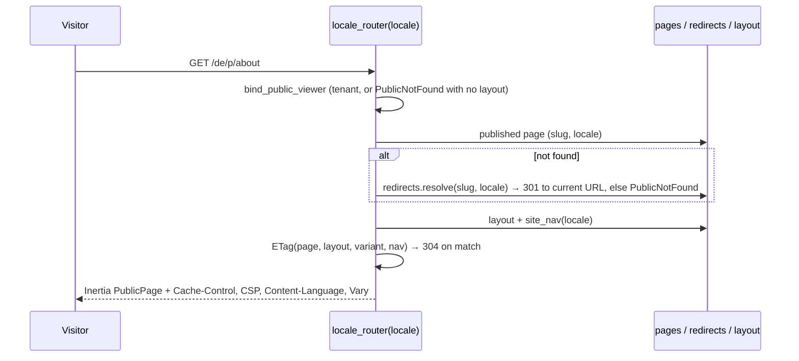

# PageBuilder architecture

Design records for the larger changes are under `docs/superpowers/specs/` at the
repo root (for example `2026-10-05-pagebuilder-tenancy-design.md`). This page
describes the code as it is.

## Boundaries

Pagebuilder depends on the framework (`simple_module_core`, `_db`, `_hosting`)
and on the framework's **Settings** module (`depends_on=["Settings"]`), nothing
else. Other modules reach it only through:

| Seam | Used for |
|---|---|
| `pagebuilder.contracts` | DTOs; everything else is internal |
| `PageDeleted` event | dropping rows keyed to a purged page |
| `registerPuckBlocks` (frontend) | adding blocks to the palette |

A module that only *might* have pagebuilder installed (news does this) imports it
lazily behind a guard.

## Data

| Table | Unique | Holds |
|---|---|---|
| `pagebuilder_pages` | `(tenant_id, locale, slug)`, `(tenant_id, translation_group, locale)` | title, `draft_data`, `published_data` (Puck JSON), status, SEO fields, nav flags, `parent_id`, `is_template`, schedule, `rejection_note`, `deleted_at` |
| `pagebuilder_page_revisions` | — | one row per transition: event, note, title, meta description, og image, `data` |
| `pagebuilder_page_redirects` | per tenant + locale + `from_slug` | old slug → `page_id` |
| `pagebuilder_layout` | one row per tenant (lazily created) | `header_data`, `footer_data` |
| `pagebuilder_layout_revisions` | — | one row per changed save |
| `pagebuilder_media` | per tenant + filename | file name, original name, type, size, dimensions, folder, alt/caption/credit, `variants` |
| `pagebuilder_snapshots`, `pagebuilder_snapshot_media`, `pagebuilder_pending_imports` | one pending import per tenant | snapshot manifests, the media each references, staged restores and their plans |

Every table carries `MultiTenantMixin`; most carry `AuditMixin`
(`created_by`/`updated_by`). `translation_group` is a generated key, not a
pointer to an "original": translations are siblings, so deleting one orphans
nothing. `parent_id` is breadcrumb-only and never part of the URL.
`published_data` is kept on unpublish and restore, which is what
`has_published` reports.

## Tenancy (#38)

The framework filters `MultiTenantMixin` tables only while a tenant is bound; with
none bound a read is **unfiltered**. So every entry point binds one itself and
never relies on one happening to be set (`pagebuilder/tenancy.py`):

| Entry point | Binding |
|---|---|
| Admin API and views | `bind_admin` router dependency: `"default"` single-tenant; resolved tenant or 403 `tenant_required` multi-tenant |
| Public viewer, sitemap | `bind_public`: `"default"`, or resolved tenant, or the same 404 an unknown slug gets |
| Media files | `MediaFiles` maps the request to `<media_root>/<tenant>/` |
| Scheduler | scans due tenants under `all_tenants()`, then one session per tenant under `tenant_context` |

`bind_admin`/`bind_public` must precede `get_db` so the commit runs while the
tenant is still bound; router-level dependencies guarantee that. The mode is
detected once, in `on_startup`, from the built middleware stack
(`tenancy.configure`), and a host fixed to a non-`default` tenant is refused. A
`text()` statement on a pagebuilder table would need its own `tenant_id`
predicate (there are none).

## Boot order and settings

Settings are DB-backed (`settings.PagebuilderSettings`, registered with
`register_module_settings`; `settings_customise_sources` returns init kwargs
only). The host hydrates them at **lifespan start**, after app construction. So:

- `register_routes` reads no setting; the admin auth and CSRF dependencies read
  `app.state.pagebuilder.settings` per request.
- `register_public_routes` does nothing. `on_startup` (`boot.py`) exempts the
  public prefixes (one per content locale, trailing `/` so `/p` never exempts
  `/pagebuilder/`), mounts one `locale_router` per locale, the default-locale
  alias, the SEO router and the media mount.
- The CSRF check is the framework's `RequiresCsrf`, wrapped in `csrf.py` so
  `csrf_protect` is read per request. The view router shares the token as the
  `csrf_token` prop; there is no middleware and no cookie.

Any field read in `on_startup` is marked `json_schema_extra=_RESTART`. Adding a
field means adding it to the class; there is no env var to add.

## Status machine (`service/_workflow.py`)

| From | Action | To | Revision | Side effects |
|---|---|---|---|---|
| any | publish | `published` | `publish` | draft → published, clear `publish_at`, `rejection_note` |
| any | unpublish | `draft` | `unpublish` | clear `unpublish_at` |
| `draft` | submit | `submitted_for_review` | `submit` | clear `rejection_note` |
| `submitted_for_review` | approve | `published` | `approve` | draft → published |
| `submitted_for_review` | reject | `draft` | `reject` | set `rejection_note` |
| `draft` + `publish_at` due | scheduler | `published` | `publish` ("Auto-published on schedule") | |
| `published` + `unpublish_at` due | scheduler | `draft` | `unpublish` | |

Anything else is 409. Saving (`PUT`) and restoring a revision write no revision;
a revision always snapshots `draft_data` after the transition. Trash is
orthogonal (`service/_trash.py`): `deleted_at` hides the row from every query via
`NOT_TRASHED`, restore sets status `draft`, and **purge** is the one method that
commits itself — it must commit before publishing `PageDeleted`, because a
subscriber's own session would otherwise hit SQLite's lock and the bus swallows
handler errors. Purge clears revisions and redirects and nulls children's
`parent_id` explicitly (SQLite does not enforce FKs and reuses ids).

## The public viewer (`endpoints/public_views.py`)

- **Title** is `meta_title` stripped, else `title`; **canonical** is
  `canonical_url` or `public_base_url` + path; **alternates** are the group's
  *published* pages, plus `x-default` = the
  default locale, omitted when fewer than two.
- **`site_nav`** (`site_nav.py`) returns published, non-trashed pages in the
  page's locale with either flag, ordered by `lower(title)`. The
  SiteHeader/SiteFooter widgets append them after the layout's links,
  skipping hrefs the layout already has (trailing slash ignored, dropdown
  children included) — `appendPages` in
  `components/widgets/_internal/site-nav-context.tsx`. Order is the layout's.
- **Preview** (`/pagebuilder/{id}/preview`, `endpoints/preview_view.py`)
  renders `draft_data` through the same `PublicPage` component with
  `index_in_search=False` and no alternates, so the preview cannot disagree
  with the live renderer. Its `preview` prop (`editor_href`, `status`) is what
  shows the draft bar; no public route sets it.
- **Not found** (`endpoints/public_not_found.py`, #89): an unknown, draft,
  trashed or not-yet-live slug renders `PageBuilder/PublicNotFound` with status
  404, one body for every cause (no oracle), `Cache-Control: no-store` plus the
  tenant `Vary`. A request that resolved no tenant gets the same page with no
  layout and no nav — never the default tenant's. A caller that prefers JSON
  by q-value (or refuses `text/html` with `q=0`) keeps
  `{"detail": "Page not found"}`; an Inertia visit always gets the page
  (`wants_json`, mirroring the framework's error-page rule). The frame's words
  (skip link, not-found copy) come from `public_copy.py` in the *content*
  locale, not the visitor's UI language.
- **`PublicShell`** (`components/public/`) is the one frame for the page, the
  preview and the 404: branding head, design-pack root class, skip link to
  `main#main`, a `min-h-dvh` column with `main` as `flex-1` (footer at the
  bottom of a short page), the preview bar, and `print.css` (header, footer,
  bar and skip link hidden in print). Author content is untouched. Public pages
  deliberately ignore `prefers-color-scheme`: the look is the design pack's.
- **Sitemap** uses a column-only query (no block JSON) and adds `xhtml:link`
  alternates per translation group.

Redirects (`redirects.py`) are locale-scoped. `record` first deletes any redirect
*from* the new slug (no loops) and from the old one (re-renames move it);
`resolve` returns the *page's* current slug, so chains collapse to one hop.

## Media

`media_service.upload` checks the declared type against the allowlist, sniffs
magic bytes, requires the two to agree, names the file `<uuid><sniffed ext>`,
streams to disk under the size cap, then generates WebP variants in a thread
(`media_images.process_image`). Usage (`media_usage.find`) searches draft and
published JSON for the asset's URL — both the per-tenant URL and the pre-#38 flat
one — ignoring trashed pages.

## Snapshots (`snapshots/`)

- **Capture** writes pages (keyed by `(locale, slug)`), redirects and the layout
  as JSON documents, media URLs rewritten to `asset://<name>` sentinels, media
  bytes into a per-tenant content-addressed blob store shared across snapshots.
  `FORMAT_VERSION` is 2; versions 1 and 2 are readable (v1 pages are read as the
  default locale). The manifest (`manifest.py`) also names the format, the
  writing package version, the tenant and a `contents` list of sections — see
  [bundle-format.md](bundle-format.md).
- **Upload** validates the zip at the boundary (`archive.py`, `validate.py`):
  entry names stay inside the destination, the manifest declares a readable
  major and no required section this build lacks (`manifest.check_manifest`), every blob hashes to its name, the expanded size stays under
  `snapshot_max_extracted_bytes`.
- **Restore** computes a plan (`plan.py`) and parks it as a `PendingImport`.
  **Approve** takes a `pre_restore` snapshot, then `apply.apply_bundle`: media
  matched by digest, pages upserted by `(locale, slug)` (a trashed match is
  revived, not duplicated), parents and redirects resolved by slug in a second
  pass, the layout saved through `LayoutService`. No page revisions are written;
  the `pre_restore` snapshot is the before-state. Nothing is deleted.
- **History marker.** A page's revision list also returns `restores`, read by
  `history.restore_markers` from approved `PendingImport` rows. At approval the
  apply writes `plan["applied"]` onto that same row — the pages it created and
  the pages whose state it actually changed, each as `{id, created_at}` — and
  the marker matches the page by that identity, so a rename, a later restore
  replacing the redirects, or a purged slug made again by hand cannot move it.
  (`created_at` is there because SQLite reuses a purged page's id.) Rows
  approved before `applied` existed fall back, best-effort, to the staged
  plan's `(locale, slug)` buckets plus the page's redirects. No table or column
  is added for it, so deleting a snapshot — which deletes its imports —
  removes its markers too. Since #80 `applied` is keyed by section, and a
  marker also counts the identities each contributed section recorded
  (`restores[].sections`), never naming them.
- **Contributed sections (#80).** Other modules register a `BundleSection`
  (`pagebuilder.contracts.bundle`) on `app.state.pagebuilder.bundle_sections`
  (`registry.py`). `sections.py` captures them after pagebuilder's own
  documents and validates them on upload; `section_restore.py` plans them at
  staging and applies them at approval. **The order inside approve** is: the
  staged plan's denials are read, every section the stager was allowed is
  re-planned (a new conflict is a 409 and nothing is written), the
  `pre_restore` snapshot is taken (sections included), `apply_bundle` writes
  pagebuilder's part, then each section applies in name order through
  `RestoreContext` — the same request session and bound tenant, with
  `from_portable` resolving media through the map the page apply just built.
  **Why one session:** a restore is one decision, so it is one transaction.
  A section that raises after flushing rolls back the pages, layout, redirects,
  every other section and the import's status together, and the `pre_restore`
  directory is removed; there is no two-phase commit to get wrong and no state
  where pages are restored but articles are half-written. The cost is a longer
  write transaction on a large bundle. Permissions are checked per section
  (`access.py`); plan rows are kept off the audited row (`plan_views.py`).
  The screens render each section from its own catalogue keys
  (`components/snapshots/SectionPlan.tsx`, `sectionSummary.ts`), so pagebuilder
  never names a contributor.

## Frontend

- **Pages.** `pagebuilder/pages/*.tsx` are Inertia pages, registered by
  `import.meta.glob`: the file name *is* the page name (`PageBuilder/PageList`).
- **Block palette.** `components/widgetCatalog.ts` lists the built-ins and their
  categories; `puckConfig.tsx` merges in `registerPuckBlocks` registrations
  (`{blocks, category?, layout?}`) and is memoised on the registry version.
  Built-in names are declared so a module cannot shadow one (a duplicate name
  throws: names are the stored `type`). `layoutPuckConfig.tsx` is a curated
  allowlist with **Site chrome**; blocks once offered there stay registered but
  hidden so saved layouts keep rendering. Heavy blocks use `lazyBlock` so their
  dependencies stay out of the entry chunk.
- **Stored data** goes through `migrateContent` on every load (editor, public
  page, layout) to upgrade older Puck shapes.
- **Markdown** lives in `utils/markdown.ts` (blocks, lists, emphasis, HTML export)
  and `utils/markdown-links.ts` (links and images with the scheme allowlist);
  `_internal/rich-text.tsx` renders them for widget fields.
- **i18n.** Every editor string is in `locales/en.json`, namespace
  `pagebuilder`. `utils/i18n.ts` derives the `keys` tree from that JSON at
  compile time, so `tsc` rejects an undefined key. Block configs are module-scope
  constants and cannot call hooks, so their labels hold keys and
  `localizeConfig.ts` resolves the assembled config (including `arrayFields` /
  `objectFields`) inside `PageEditor` and `LayoutEditor`. `defaultProps` stay
  literal: they are seed content saved into the document.
- **Library helpers.** `conversion/` (`blocksToHtml`) and `translation/`
  (extract and re-apply translatable strings) are pure functions with no storage.

## Rules for contributors

- **300-line cap** on every `.py`, `.ts` and `.tsx`, enforced by
  `scripts/check_file_size.py` (`make lint`). Nothing under `modules/` is exempt;
  that is why `service/`, `models/`, `endpoints/api/` and `contracts/schemas/`
  are packages of mixins and sub-routers.
- **Never add a file under `pagebuilder/pages/` unless it is a real Inertia
  page.** A stray `.tsx` there silently registers a page. Extractions go to
  `components/`, `hooks/` or `utils/`.
- **Every slug lookup, redirect and claim takes a locale.** One that does not is
  how `/de/p/x` starts serving the English page.
- **Every new entry point binds a tenant** (`bind_admin`, `bind_public`, or
  `tenant_context` outside a request). Another module reads these
  tables only through `pagebuilder.contracts` (e.g. `search_pages`), which pins
  the `tenant_id` the caller names.
- **No env vars.** New settings go on `PagebuilderSettings`; boot-time ones are
  read from `app.state.pagebuilder.settings` in `on_startup` and marked restart.
- **No migrations in the module.** Hosts autogenerate against the models.
- **Literal API paths before `/pages/{page_id}`**, or `trash` parses as an id
  (422). Same for `/uploads/{id}/checked`, which is why `media_detail` is
  included before `uploads`.
- New UI strings go in `locales/en.json`; `utils/i18n.test.ts` rejects unused
  entries and unfilled placeholders.

## File map

| Path | Role |
|---|---|
| `module.py`, `boot.py` | registration hooks; startup wiring |
| `settings.py`, `locales.py` | DB-backed settings; content-locale helpers |
| `tenancy.py`, `access.py`, `csrf.py`, `permissions.py` | tenant binding; admin route dependencies; CSRF; permissions and roles |
| `models/`, `contracts/` | tables; public DTOs and `PageDeleted` |
| `service/` | `PagesService` (CRUD, workflow, revisions, trash, translations) |
| `layout_service.py`, `site_nav.py`, `redirects.py`, `public_copy.py` | layout; nav flags; old slugs; the public frame's strings per content locale |
| `media_*.py` | upload, images, queries, files, usage |
| `scheduler.py` | per-tenant publish/unpublish/purge loop |
| `snapshots/` | capture, archive, validate, plan, apply |
| `endpoints/api/` | JSON API, one file per resource |
| `endpoints/views.py`, `content_views.py`, `preview_view.py` | Inertia admin views |
| `endpoints/public_views.py`, `public_not_found.py`, `seo.py` | public viewer and its 404; sitemap and robots |
| `pages/`, `components/`, `hooks/`, `utils/` | frontend |
